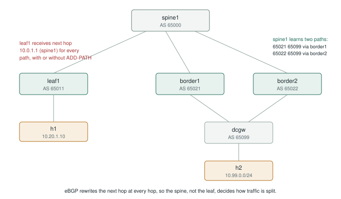
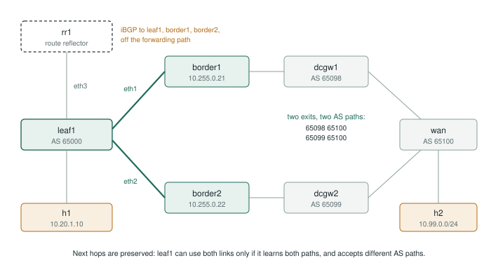
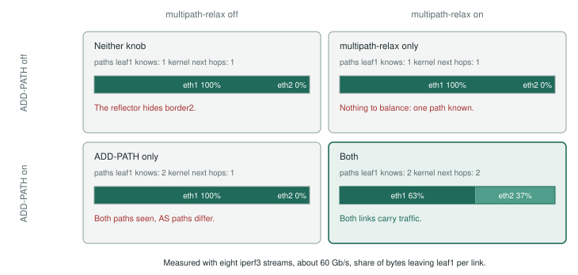

# Lab: BGP ADD-PATH, where it changes forwarding and where it only changes what you see

A two-phase lab on FRR (the routing suite inside Cumulus Linux and SONiC), run with containerlab.

| Phase | Design | Question it answers |
|---|---|---|
| **A** | eBGP fabric, one ASN per switch | Does ADD-PATH give a leaf more paths? (It gives visibility, not forwarding. Multipath-relax is what creates ECMP.) |
| **B** | iBGP with an off-path route reflector, destination dual-homed to two gateway ASes | What does a route reflector hide? Here neither ADD-PATH nor multipath-relax changes anything alone; together they put the idle link to work. |




**Time:** about 90 minutes by hand, or 10 minutes with `verify.py`. **Resources:** 4 vCPU, 4 GB RAM is plenty (seven to nine small containers).

**Validated:** FRR 10.2.1 with containerlab 0.81.1 on Ubuntu 24.04: phase A 6/6, phase B 9/9 with `verify.py`. Raw outputs are in [`results/`](results/), packet captures in [`captures/`](captures/).
**Standards:** ADD-PATH is RFC 7911; route reflection is RFC 4456.

> Commands and expected behavior below are written for FRR 10.x. Outputs differ slightly between releases. **Capture your real outputs**; they become the screenshots for the article and the talk.

---

## 0. Prepare (once)

```bash
sudo apt-get update && sudo apt-get install -y docker.io      # Docker (Ubuntu)
sudo usermod -aG docker $USER                                   # Docker without sudo
bash -c "$(curl -sL https://get.containerlab.dev)"              # containerlab
sudo usermod -aG clab_admins $USER                              # containerlab without sudo
# log out and back in, then:
docker pull quay.io/frrouting/frr:10.2.1
docker pull nicolaka/netshoot:latest
```

Regenerate configurations at any time with `python3 generate.py` (all addressing lives there).

Shortcuts used below (bash):
```bash
v() { docker exec "clab-addpath-$1-$2" vtysh -c "$3"; }      # v a spine1 "show bgp summary"
x() { lab=$1 node=$2; shift 2; docker exec "clab-addpath-$lab-$node" "$@"; }
```

### Automated run (recommended before every presentation)

`verify.py` runs every step below, asserts the expected state, measures traffic and failover, and saves all outputs to `results/<frr-version>/`. Standard library only, no virtual environment needed.

```bash
cd phase-a-ebgp && containerlab deploy -t topology.clab.yml && cd ..
python3 verify.py a
cd phase-a-ebgp && containerlab destroy -t topology.clab.yml --cleanup && cd ..
cd phase-b-ibgp-rr && containerlab deploy -t topology.clab.yml && cd ..
python3 verify.py b --failover
cd phase-b-ibgp-rr && containerlab destroy -t topology.clab.yml --cleanup && cd ..
```

Each phase must start from a fresh deploy, because the steps change the configuration. The manual walkthrough below is the same sequence, for presenting live.

---

## Phase A: eBGP fabric

```bash
cd phase-a-ebgp && containerlab deploy -t topology.clab.yml && cd ..
```

### A1. Baseline: every session up
```bash
v a spine1 "show bgp ipv4 unicast summary"
```
Look for: three neighbors, each with a prefix count (not `Active`/`Connect`). **Capture.**

### A2. What the spine knows
```bash
v a spine1 "show bgp ipv4 unicast 10.99.0.0/24"
x a spine1 ip route show 10.99.0.0/24
```
Look for: **two paths**, AS paths `65021 65099` and `65022 65099`, one marked `best`, **neither marked `multipath`**. The kernel route has **one** next hop.

Why: the two paths come from different neighboring ASes. By default BGP only load-shares across paths whose AS paths are identical. **Capture.**

### A3. Put traffic on it
Terminal 1:
```bash
x a h2 iperf3 -s -D
./watch-links.sh clab-addpath-a-spine1 eth2 eth3
```
Terminal 2:
```bash
x a h1 iperf3 -c 10.99.0.10 -P 8 -t 60
```
Look for: all traffic on one spine link (toward the best path's border), the other near zero. **Capture the watch output.**

### A4. Turn on multipath-relax (the knob that actually creates ECMP here)
```bash
docker exec -it clab-addpath-a-spine1 vtysh
configure terminal
router bgp 65000
 bgp bestpath as-path multipath-relax
end
show bgp ipv4 unicast 10.99.0.0/24
```
Look for: both paths now marked `multipath`; `ip route show 10.99.0.0/24` shows **two next hops**. Re-run the iperf3 test: traffic now spreads over eth2 and eth3, per flow, so not perfectly even. **Capture both.**

Talking point: unequal shares with 8 flows are the hash collisions from the [ECMP article](https://networkfactory.net/articles/one-link-fails-every-job-slows/).

### A5. Turn on ADD-PATH from the spine to the leaf
```bash
docker exec -it clab-addpath-a-spine1 vtysh
configure terminal
router bgp 65000
 address-family ipv4 unicast
  neighbor 10.0.1.0 addpath-tx-all-paths
end
clear bgp ipv4 unicast 10.0.1.0
```
The capability is negotiated when the session opens, so the session is reset. Then:
```bash
v a spine1 "show bgp neighbors 10.0.1.0"        # find the AddPath capability lines
v a leaf1  "show bgp ipv4 unicast 10.99.0.0/24"
x a leaf1  ip route show 10.99.0.0/24
```
Look for: leaf1 now has **two paths** (AS paths `65000 65021 65099` and `65000 65022 65099`, each with an Addpath ID), **both with next hop 10.0.1.1**. The kernel route still has **one** next hop. **Capture all three.**

**The finding:** in an eBGP fabric the spine rewrites the next hop, so extra paths collapse onto the same next hop at the leaf. ADD-PATH adds visibility (the leaf can see both exits and both AS paths) but does not change forwarding. The spine's multipath does the balancing.

### A6 (optional). Failure
Terminal 1: `./failover-test.sh a`. Terminal 2, during the run:
```bash
x a border1 ip link set eth2 down     # border1 loses the gateway
sleep 5; x a border1 ip link set eth2 up
```
Record the packet loss. Repeat with and without multipath-relax.

```bash
cd phase-a-ebgp && containerlab destroy -t topology.clab.yml --cleanup && cd ..
```

---

## Phase B: iBGP with an off-path route reflector

The destination, h2 behind `wan` (AS 65100), is reachable through two gateways in different ASes: dcgw1 (65098) behind border1, dcgw2 (65099) behind border2. So the two exits have **different AS paths**: `65098 65100` and `65099 65100`.

```bash
cd phase-b-ibgp-rr && containerlab deploy -t topology.clab.yml && cd ..
```

### B1. Baseline: underlay and sessions
```bash
v b leaf1 "show ip ospf neighbor"             # rr1, border1, border2 in Full state
v b rr1   "show bgp ipv4 unicast summary"     # three clients established
v b wan   "show bgp ipv4 unicast summary"     # dcgw1 and dcgw2 established
```

### B2. What the route reflector knows, and what it says
```bash
v b rr1   "show bgp ipv4 unicast 10.99.0.0/24"
v b leaf1 "show bgp ipv4 unicast 10.99.0.0/24"
x b leaf1 ip route show 10.99.0.0/24
```
Look for: rr1 has **two paths** (next hops 10.255.0.21 and 10.255.0.22); leaf1 has **one**, and the kernel route uses **eth1 only**. A reflector advertises only its best path.

### B3. Traffic: one link idle
```bash
x b h2 iperf3 -s -D
./watch-links.sh clab-addpath-b-leaf1 eth1 eth2     # terminal 1
x b h1 iperf3 -c 10.99.0.10 -P 8 -t 60              # terminal 2
```
Look for: everything on eth1, nothing on eth2, although border2 and its link are healthy.

### B4. multipath-relax alone: no change
```bash
docker exec -it clab-addpath-b-leaf1 vtysh
configure terminal
router bgp 65000
 bgp bestpath as-path multipath-relax
end
show bgp ipv4 unicast 10.99.0.0/24
```
Look for: still one path, one next hop; re-run iperf3, still 100% on eth1. Multipath can only balance across paths the leaf knows. Then remove it (`no bgp bestpath as-path multipath-relax`).

### B5. ADD-PATH alone: two paths, still one link
```bash
docker exec -it clab-addpath-b-rr1 vtysh
configure terminal
router bgp 65000
 address-family ipv4 unicast
  neighbor 10.255.0.11 addpath-tx-all-paths
end
clear bgp ipv4 unicast 10.255.0.11
```
The capability is negotiated when the session opens, so the session is reset. Then:
```bash
v b rr1   "show bgp neighbors 10.255.0.11"        # AddPath: IPv4 Unicast: TX advertised
v b leaf1 "show bgp ipv4 unicast 10.99.0.0/24"
x b leaf1 ip route show 10.99.0.0/24
```
Look for: leaf1 has **two paths** with Addpath IDs, **neither marked `multipath`**, and the kernel route still has **one** next hop. Re-run iperf3: still 100% on eth1. Why: the AS paths differ, and BGP only load-shares across identical AS paths by default.

### B6. Both knobs: both links
Turn multipath-relax back on at leaf1 (as in B4), keep ADD-PATH on rr1:
```bash
v b leaf1 "show bgp ipv4 unicast 10.99.0.0/24"
x b leaf1 ip route show 10.99.0.0/24
```
Look for: both paths `multipath`, **two kernel next hops via eth1 and eth2**. Re-run iperf3: traffic on both links (63/37 in the recorded run, per-flow hashing). **This is the money shot.**

| | multipath-relax off | multipath-relax on |
|---|---|---|
| **ADD-PATH off** | 1 path, 100% on eth1 | 1 path, 100% on eth1 |
| **ADD-PATH on** | 2 paths, 100% on eth1 | 2 paths, **63% / 37%** |



### B7. Selection policy: all paths, or best per AS?
```bash
docker exec -it clab-addpath-b-rr1 vtysh
configure terminal
router bgp 65000
 address-family ipv4 unicast
  no neighbor 10.255.0.11 addpath-tx-all-paths
  neighbor 10.255.0.11 addpath-tx-bestpath-per-AS
end
clear bgp ipv4 unicast 10.255.0.11
```
Look for: leaf1 still has **two paths**, because the exits lead to different neighboring ASes (65098, 65099). Ask the audience what would happen if both exits were behind the same AS: one path, and the second link goes idle again. The selection policy is a design decision, not a default.

### B8. Does ADD-PATH speed up failover? (measured: no, and it can loop)
`python3 verify.py b --failover` fails border1's gateway link three times in each of three cases (multipath-relax on at leaf1), with a ping flow at 100 per second hashed through border1:

| Case | Pings lost (10 ms each) | TTL exceeded |
|---|---|---|
| No ADD-PATH | 14, 15, 15 | 0 |
| ADD-PATH to leaf1 | 14, 15, 15 | 0 |
| ADD-PATH to leaf1 and both borders | 15, 15, 15 | **6, 6, 6** |

What it shows:
- **Convergence did not improve.** About 150 ms in every case: the time for border1's withdrawal to travel through rr1 to leaf1.
- **Backup paths at the borders created a transient loop.** border1's backup exit is border2, reachable only back through leaf1, which keeps sending the flow to border1 until the withdrawal arrives. The capture `captures/b3-failover-microloop.pcap` shows one ping crossing the leaf1–border1 link 63 times in 0.3 ms before border1 returns `Time to live exceeded`. Timeline from the capture: 0–66 ms dropped at border1, 66–154 ms looping, then via border2.
- **Compare phase A:** about 60 ms, because the spine peers directly with both borders.

Design lesson: a backup path speeds up failover only if it is reachable without going back through the router that is still sending you the traffic. Otherwise, protect the ingress: fast detection (BFD) and next-hop tracking.

### B9. Two paths as a safety net: local versus remote failure
Also run by `verify.py b --failover`: leaf1 loses its own link eth1 while the flow uses it. A tcpdump on h2 counts the requests that arrive, so the forward direction is measured separately from the round trip.

| leaf1 holds | Forward lost (h1 to h2) | Round trip lost |
|---|---|---|
| Two paths (ADD-PATH and multipath-relax) | **0, 0, 0** | 15, 15, 15 |
| One path | 11, 11, 12 | 15, 15, 15 |

- **With two paths installed, a local failure costs nothing.** The kernel drops the failed next hop from the ECMP group the moment the interface goes down; BGP is not involved.
- **With one path, the leaf waits** for OSPF and BGP next-hop tracking to invalidate the path and for rr1 to send the other one: about 115 ms.
- **The round trip still loses about 150 ms either way,** because for the return traffic the failure is remote: wan keeps hashing some flows toward dcgw1 and border1 until the withdrawal reaches it.

**The trap this lab hit first:** with FRR's `ip nht resolve-via-default` on (as it was in this container image), BGP considered the border loopbacks reachable through the management network's default route after eth1 went down. The leaf kept a dead path and sent traffic into the management network: about 5 seconds of blackhole, until the iBGP session timed out. The generated configurations now set `no ip nht resolve-via-default` on every fabric router. Any default or summary route that covers your BGP next hops has the same effect.

```bash
cd phase-b-ibgp-rr && containerlab destroy -t topology.clab.yml --cleanup && cd ..
```

---

## Packet captures

`capture.py` records the key moments with tcpdump in a sidecar container that shares the router's network namespace (the FRR containers need nothing extra). Deploy a phase fresh, then:

```bash
python3 capture.py a     # a1/a2: spine1 to leaf1 updates, without and with ADD-PATH
python3 capture.py b     # b1/b2: rr1 to leaf1 updates; b3: the failover micro-loop
```

Open the files in `captures/` with Wireshark. Useful display filters:

| Filter | What it shows |
|---|---|
| `bgp.type == 1` | OPEN messages; expand *Support for Additional Paths (69)* to see Send/Receive |
| `bgp.nlri_path_id` | UPDATEs carrying Path IDs (Wireshark decodes them because the OPEN is in the capture) |
| `bgp.type == 2 && ip.src == 10.255.0.1` | what the reflector tells leaf1: compare b1 (one path) and b2 (two paths, two next hops) |
| `icmp.seq == 279 \|\| icmp.type == 11` | in b3: one ping looping with decreasing TTL, then the Time-to-live exceeded |

The figures in `images/` are generated from these files and from `results/`: `python3 shots.py` (screenshots) and `python3 diagrams.py` (diagrams).

---

## What to take away

| Design | Who decides the split | Does ADD-PATH change forwarding? | The knob that matters |
|---|---|---|---|
| eBGP fabric, next hop rewritten | Each hop, using its own multipath | No: paths collapse onto one next hop | `bgp bestpath as-path multipath-relax` on every tier |
| iBGP with an in-path reflector (the spine) | The reflector, which forwards traffic too | Little: the spine balances anyway | iBGP multipath on the reflector |
| iBGP with an off-path reflector, exits in the same AS | The receiver of the routes | **Yes**: hidden exits become usable next hops | ADD-PATH on the reflector, `maximum-paths ibgp` on clients |
| iBGP with an off-path reflector, exits in different ASes | The receiver of the routes | **Only with multipath-relax** on the receiver | ADD-PATH, `maximum-paths ibgp` and multipath-relax |
| Overlays with encapsulation (EVPN, MPLS, SRv6) | The ingress, which tunnels to the next hop | **Yes**: next hops are tunnel endpoints | ADD-PATH, plus a selection policy you chose on purpose |

Costs to mention: more paths means more memory and more update processing on every receiver, and the selection policy (all, best-per-AS, best N) decides how much you pay.

## Presenting it (15 minutes)

1. **The puzzle (1 min):** two healthy exits, one link idle. Show B3.
2. **The cause (2 min):** a route reflector advertises only its best path. Show B2.
3. **First reflex, no change (1 min):** multipath-relax on the leaf. Show B4.
4. **The famous fix, no change (3 min):** ADD-PATH. The leaf sees two paths, uses one. Show B5 and the b2 capture with Path IDs 3 and 4. Ask why before revealing: the AS paths differ.
5. **Both knobs (2 min):** traffic on both links. Show B6 and the 2x2 table.
6. **The counter-example (2 min):** the eBGP fabric, where ADD-PATH changes nothing (A5, a2 capture: two Path IDs, one next hop).
7. **The myth (3 min):** "ADD-PATH gives you fast failover." Show B8, then the b3 capture with the looping ping. Then B9: two installed paths do protect against a local failure, and the next-hop-tracking trap.
8. **The decision table (1 min).**

Equivalent configuration for Cumulus Linux NVUE and Cisco NX-OS is in [EQUIVALENTS.md](EQUIVALENTS.md).

*Configurations are for a lab. Validate behavior against the documentation of the release you run before production.*
