# Lab: multi-vendor EVPN-VXLAN, one tenant across NX-OS and Cumulus Linux

Two leaf-spine fabrics from two vendors, joined by one link, carrying one tenant: a stretched VLAN, routed
subnets on both sides, the same anycast gateway everywhere. Every scenario is driven by script, captured on the
wire, and checked against what the control plane says should happen.

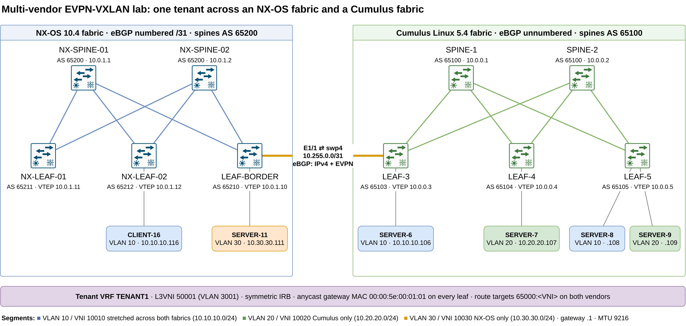

| | NX-OS fabric | Cumulus fabric |
|---|---|---|
| Software | NX-OSv 9000 10.4(2)F | Cumulus VX 5.4.0 |
| Underlay | eBGP over numbered /31 links | eBGP unnumbered (RFC 8950 next hops) |
| ASNs | spines 65200, leaves 65210-65212 | spines 65100, leaves 65103-65105 |
| VTEPs | 10.0.1.10-12 | 10.0.0.3-5 |
| Interconnect | LEAF-BORDER E1/1 | LEAF-3 swp4 |

The interconnect is a plain /31 with one eBGP session carrying IPv4 (loopbacks) and L2VPN EVPN. The spines and the
border leaf pass EVPN routes on with the next hop unchanged, so every leaf builds tunnels straight to every other
leaf, whichever vendor it is.

**Tenant TENANT1:** L3VNI 50001 (VLAN 3001), symmetric IRB, anycast gateway MAC `00:00:5e:00:01:01`, explicit
route targets `65000:<VNI>` on both vendors.

| VLAN | VNI | Subnet | Where | Hosts |
|---|---|---|---|---|
| 10 | 10010 | 10.10.10.0/24 | both fabrics | SERVER-6 (.106), SERVER-8 (.108), CLIENT-16 (.116) |
| 20 | 10020 | 10.20.20.0/24 | Cumulus only | SERVER-7 (.107), SERVER-9 (.109) |
| 30 | 10030 | 10.30.30.0/24 | NX-OS only | SERVER-11 (.111) |

Hosts are [netshoot](https://github.com/nicolaka/netshoot) containers.

## Scenarios

1. **One VLAN across two vendors**, and what ARP suppression really needs ([details](#scenario-1-one-vlan-across-two-vendors))
2. **Anycast gateway and symmetric IRB** between VLAN 20 and VLAN 30 ([details](#scenario-2-one-anycast-gateway-symmetric-irb-between-vendors))
3. **Host mobility**: a host moves from one vendor to the other (in progress)
4. **Break it**: underlay MTU and automatic route targets (in progress)

## Scenario 1: one VLAN across two vendors

SERVER-6 sits behind a Cumulus leaf, CLIENT-16 behind an NX-OS leaf, both in VLAN 10. They ping each other while
three captures run at once: on the inter-fabric link and on both access ports. The scenario runs three times.

```bash
python3 scenarios/s1_stretched_l2.py a   # CLIENT-16 silent, NX-OS suppress-arp off
python3 scenarios/s1_stretched_l2.py b   # CLIENT-16 pinged its gateway once, NX-OS suppress-arp off
python3 scenarios/s1_stretched_l2.py c   # suppress-arp on NX-OS too (TCAM carve + reload first)
```

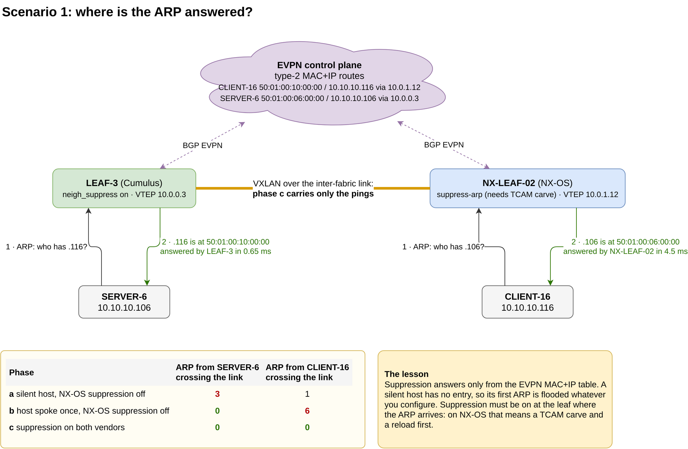

**Phase a: the silent host.** Cumulus has ARP suppression on from the start, yet SERVER-6's ARP for CLIENT-16
crosses the link three times, once per NX-OS VTEP. Neither vendor has a MAC+IP route for 10.10.10.116, because
CLIENT-16 has never sent anything a leaf could learn its IP from. Suppression answers from the EVPN table; an
empty table means a flood.

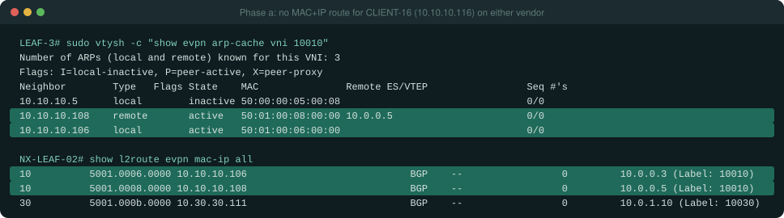
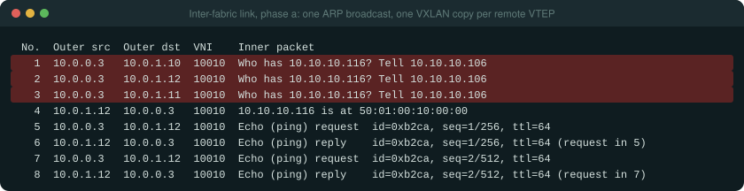
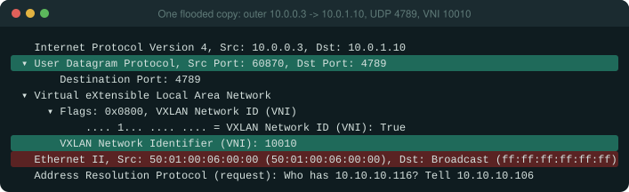

**Phase b: the host has spoken once.** One ping from CLIENT-16 to its gateway, and NX-LEAF-02 advertises a type-2
MAC+IP route. LEAF-3 now answers SERVER-6's ARP itself, in 0.65 ms, and nothing crosses the link. The other
direction still floods: NX-LEAF-02 has no suppression, so CLIENT-16's ARP goes to all three Cumulus VTEPs.

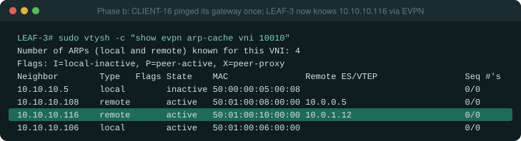
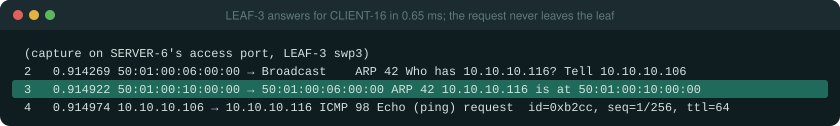
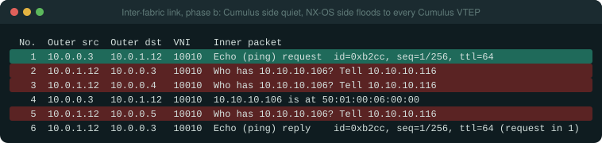

**Phase c: suppression on both vendors.** NX-OS refuses `suppress-arp` until a TCAM region exists for it:

```
ERROR: Please configure TCAM region for Ingress ARP-Ether ACL before configuring ARP supression.
```

The lab borrows space from the IPv4 RACL region (it has no routed ACLs), carves `arp-ether 256 double-wide` and
reloads the three NX-OS leaves. After that, no ARP crosses the link in either direction.

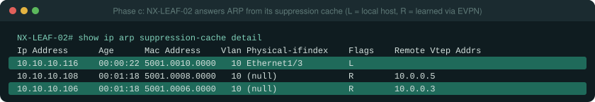
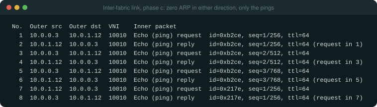

| Phase | ARP from SERVER-6 crossing the link | ARP from CLIENT-16 crossing the link |
|---|---|---|
| a: silent host, NX-OS suppression off | 3 | 1 (unicast re-check) |
| b: host spoke once, NX-OS suppression off | 0 | 6 (two ARPs x three Cumulus VTEPs) |
| c: suppression on both vendors | 0 | 0 |

**What to take away**

- ARP suppression is only as good as the MAC+IP table behind it. Silent hosts (a printer, a standby VM) are
  flooded the first time, whatever you configure.
- Configure suppression on every leaf. One vendor without it floods the whole VNI, across the interconnect, in
  copies: ingress replication sends one copy per remote VTEP.
- On Nexus 9000, `suppress-arp` needs a TCAM carve and a reload. Plan it into the first deployment, not a change
  window later.
- Observed on NX-OSv 9000 only: when NX-LEAF-02 floods an ARP into VXLAN, the inner Ethernet source is the switch's
  own MAC, while the ARP payload keeps the host's MAC. Hosts learn from the payload, so nothing breaks. This may be
  a quirk of the virtual platform; check it on hardware before relying on it either way.
- NX-OSv 9000 keeps no boot variable by default, so the first `reload` stops at `loader >`. The generated
  configuration sets `boot nxos bootflash:...`.

## Scenario 2: one anycast gateway, symmetric IRB between vendors

SERVER-7 (VLAN 20, Cumulus only) pings SERVER-11 (VLAN 30, NX-OS only). No leaf has both VLANs, so the packet is
routed at the ingress leaf, carried across in the L3VNI, and routed again at the egress leaf.

```bash
python3 scenarios/s2_anycast_irb.py a   # cold: LEAF-BORDER's ARP entry for SERVER-11 is cleared first
python3 scenarios/s2_anycast_irb.py b   # warm
```

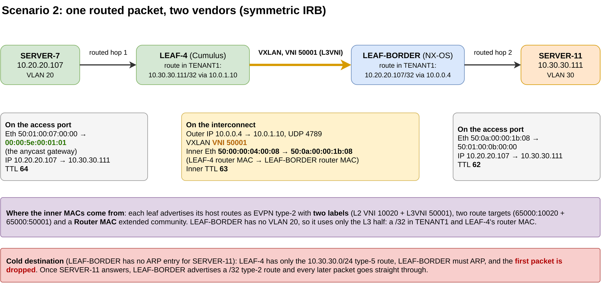

**One gateway, two vendors.** Cumulus calls it VRR, NX-OS calls it the anycast gateway; configured with the same
MAC, the hosts cannot tell which vendor answers.

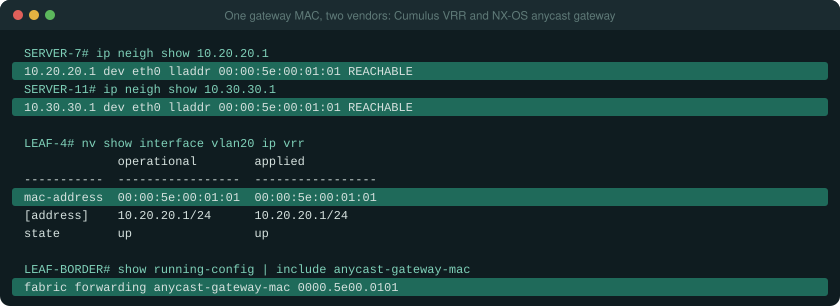

**The packet on the wire.** On the interconnect the routed packet travels in VNI 50001, not in VNI 10020 or 10030.
The inner Ethernet header goes from LEAF-4's router MAC to LEAF-BORDER's router MAC, and the inner TTL is already
63. SERVER-11 receives it with TTL 62: two routing hops, one on each vendor.

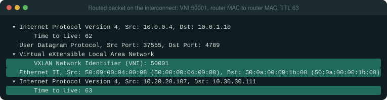

**Where those MACs come from.** SERVER-7's MAC+IP route reaches LEAF-BORDER with two labels (10020 and 50001),
two route targets and LEAF-4's Router MAC. LEAF-BORDER has no VLAN 20, so it imports only the L3 half: a /32 in
TENANT1.

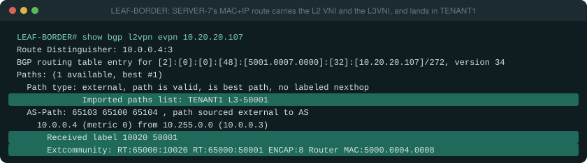

**The cold destination.** If LEAF-BORDER has no ARP entry for SERVER-11, LEAF-4 only has the /24 type-5 route.
Request 1 reaches LEAF-BORDER, which ARPs for SERVER-11 and drops the packet that triggered the ARP. From then on
LEAF-BORDER advertises a /32 and nothing else is lost.

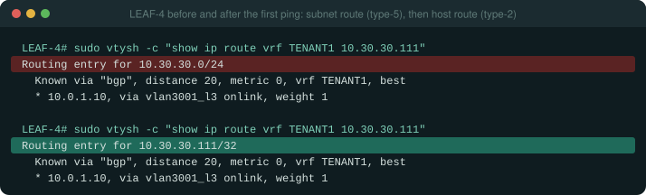
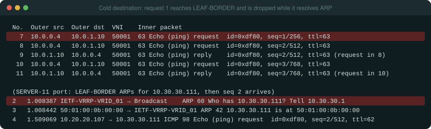

**What to take away**

- Same anycast MAC on every leaf of every vendor, set explicitly. Nothing in either platform's defaults makes them
  match.
- Explicit route targets let the two vendors exchange the L3VNI routes; the Router MAC community is what makes
  symmetric IRB work between them, and both vendors carry it.
- One lost packet to a silent host is normal behaviour for a glean, not a fabric fault. Health checks that send a
  single probe to a silent host will raise false alarms.
- The lab uses `00:00:5e:00:01:01` as the anycast MAC, which Wireshark shows as `IETF-VRRP-VRID_01`: it is the
  VRRP MAC for VRID 1 (RFC 5798). Harmless here, but in production pick a locally administered MAC
  (second hex digit 2, 6, A or E) so it cannot collide with VRRP.

## Files

| Path | What it is |
|---|---|
| `generate.py` | The source of truth: every address, ASN, VNI and route target, and the generator for all configurations |
| `configs/` | Generated NVUE commands (Cumulus), NX-OS configurations, host addressing |
| `scenarios/` | One script per scenario: set up, capture, collect show commands |
| `shots.py` | Renders `results/` and `captures/decoded/` as the screenshot panels in `images/` |
| `tools/` | Console automation over EVE-NG (telnet), the EVE-NG REST API, remote packet capture |
| `diagrams/` | draw.io sources and exports |

## Build it on EVE-NG

You need EVE-NG with the Cumulus VX 5.4 and Nexus 9000v 10.4 images (not included: get them from NVIDIA and Cisco),
and the netshoot image adapted for EVE-NG (EVE needs an absolute path as the container command):

```bash
docker build -t netshoot-eve:latest -f tools/Dockerfile.netshoot-eve tools/
```

Lab credentials are lab-only values set by the first-boot scripts: `cumulus` / `NetFactory#Lab1` and
`admin` / `NetFactory#Lab1`. Change them if your lab is reachable from anything that matters.

*Configurations are for a lab. Validate them against the documentation of your release before production.*
